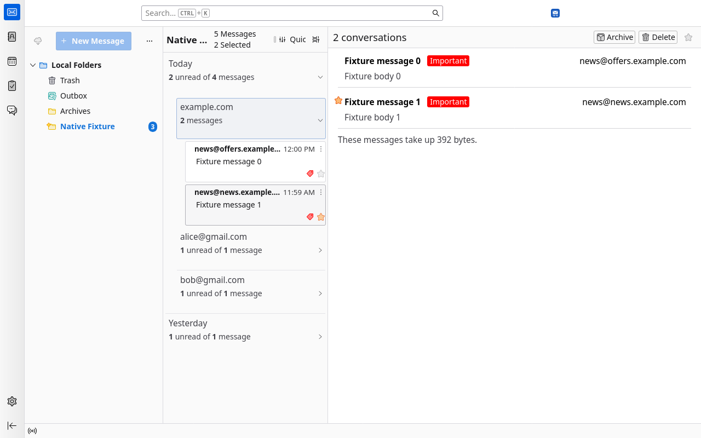
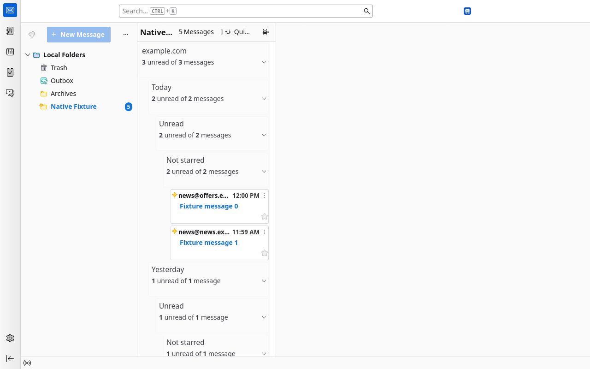

# Native Sort & Groups

Combine Thunderbird’s native sort fields in the order you choose. Turn **Grouped by Sort** on for nested collapsible groups, or off for a flat sorted list. The native cards/table, message reader, group summary and common mail commands remain in place.

[简体中文说明](README.zh-CN.md)

## Install and use

Requires **Thunderbird 158.x**; tested on 158.0.1. Download the XPI from [Releases](https://github.com/wu5bocheng/thunderbird-native-sort-groups/releases), then use **Add-ons and Themes → gear menu → Install Add-on From File**.

1. Open the message list’s **Sort** menu.
2. Click fields to append them in order. Selected fields show **1 ·, 2 ·, 3 · …**. Click a selected field to remove it; at least one remains. The menu stays open for multiple selections.
3. Enable **Grouped by Sort** to make each field one level. New groups start collapsed. Disable it to show a flat list without group headers.
4. Click a group title for the native message summary. Use the arrow or keyboard to expand it. Click a message to read it normally.

All 16 offered fields can be combined, including Sender domain. Ascending/descending applies to the whole combination. Settings are saved per folder. Clicking a table column selects that single field. Native threaded mode uses Thunderbird’s own conversation view.

Sender domain merges business subdomains using Thunderbird’s public suffix service. Public providers such as Gmail and Outlook remain separate by full sender address. Domain categories are ordered by the latest message in each category, rather than alphabetically. Dates use local relative ranges when grouped, precise timestamps when flat. Overlapping selections are deduplicated by message URI.





## Native integration and limits

Read/unread, stars, tags, junk, copy/move, archive and deletion use native commands, confirmations and undo. Quick Filter and saved searches retain their native message scope. Grouping does not move or create mail folders.

This uses a **Thunderbird Experiment API with unrestricted application access**, because the stable MailExtension API cannot provide arbitrary native nested grouping or ordered multi-field menu selection. It does not modify Thunderbird installation files. Compatibility is deliberately limited to 158.x. Other extensions reading a single native sort field may not see the full combination.

Message-list drag-and-drop moving and certain thread-specific commands are disabled in this adapter: watch/ignore thread, mark thread read, select thread, next unread thread and select flagged. Use the native move menu or switch to native threaded mode. Live IMAP disconnection/concurrency behavior has not been verified. This extension does not perform advertising detection or duplicate deletion.

## Languages and privacy

Uses the standard WebExtension `i18n` API and `_locales`, automatically following Thunderbird’s UI language with English fallback. Added strings support English, Simplified/Traditional Chinese, German, French, Spanish and Japanese. Existing native labels, readers and summaries retain Thunderbird’s own localization. English and Simplified Chinese were tested end to end; other translations have resource validation but still welcome human review.

Mail headers are processed locally to sort and summarize. No extension network requests, telemetry, external services or remote code. Folder URIs and sort preferences persist locally in `extensions.nativeDateDomainGroups.sortConfigs`, including after disabling/uninstalling; group selection and expansion state stay in memory. User-invoked native mail operations follow the account’s usual server synchronization. See [PRIVACY.md](PRIVACY.md).

## Build and verify

Python 3 standard library only; no package install or downloads are needed to build:

```sh
python3 build.py
node --test tests/model.test.mjs tests/locales.test.mjs
python3 tests/native_integration.py --binary /absolute/path/to/thunderbird
# Optional official matching language pack, downloaded separately:
python3 tests/native_integration.py --binary /absolute/path/to/thunderbird --locale zh-CN --langpack /path/to/zh-CN.xpi
```

The build writes `../thunderbird-native-groups-0.4.0.xpi` reproducibly with fixed archive metadata. It concatenates the readable model into the Experiment implementation; no transpilation, minification or third-party libraries. Test scripts create temporary profiles and synthetic local mail; they do not connect to existing accounts. Screenshots come from these isolated profiles, not private mail.

Model tests cover hierarchy, time/domain ordering, selection deduplication and flat combinations. Thunderbird integration covers all 16 fields/levels, checked-state feedback, mouse/keyboard actions, native reading/summary/editing, delete/move/archive undo, new mail, Quick Filter, cross-folder unread searches, table/cards, disabling and preference restoration. See [submission/REVIEWER-NOTES.md](submission/REVIEWER-NOTES.md).

## Contribute and support

[Open an issue](https://github.com/wu5bocheng/thunderbird-native-sort-groups/issues) for bugs or translation corrections. Include Thunderbird version, locale and reproduction steps, without private mail or credentials. Translations live in `_locales/<locale>/messages.json`; preserve the message keys. New Thunderbird major versions need native integration testing before widening compatibility.

Author: [wu5bocheng](https://github.com/wu5bocheng). Licensed under [MPL-2.0](LICENSE).
